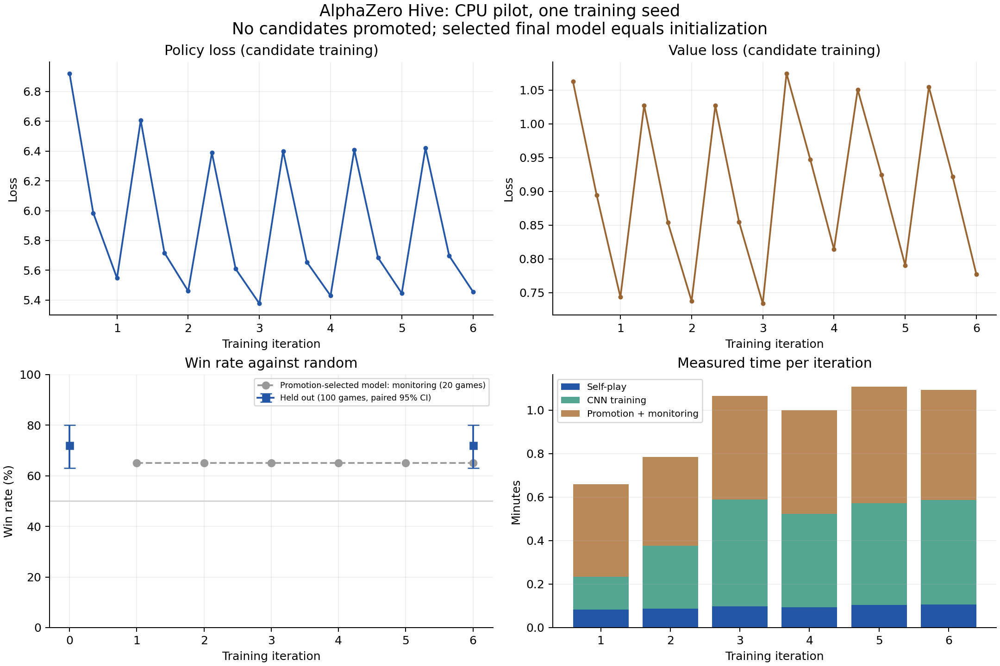

# CPU pilot — 2026-10-22

Pilot does not establish improved playing strength.

| Held-out comparison | Wins / losses / draws | Win rate [paired 95% CI] |
|---|---:|---:|
| Initial vs random | 72 / 28 / 0 | 72% [63%, 80%] |
| Selected final vs random | 72 / 28 / 0 | 72% [63%, 80%] |
| Selected final vs initial | 50 / 50 / 0 | 50% [50%, 50%] |

Paired change against random: **+0 pp [+0, +0]**.

Training completed 6 iterations and 60 self-play games. Accepted iterations: []. Measured training-process wall time: 5.79 min; peak RSS: 0.67 GiB.

Selected model state differs from exact initialization: **False**. Model-state fingerprints include weights and BatchNorm buffers; file hashes alone can differ because checkpoint filenames differ.

Both neural agents used 25 MCTS simulations, identical rules and 50 games with each color per opponent. The initial opponent is the exact saved initial.pt checkpoint. Holdout seed 300001 was fixed before training and is separate from promotion/monitoring seeds. Intervals resample color-swapped pairs, not individual games.

The paired difference intervals collapse because the selected and initial models are identical and were evaluated on matching seeded/color pairs. This does not remove uncertainty about future training runs.

Loss curves include rejected candidate training. Monitoring and holdout win rates use separate seeds and sample sizes, as marked in the plot. A lower training loss alone does not establish stronger play.

This compact network has 4,246,816 parameters; it is not the paper's 521,174,688-parameter model. The four-neighbor/29-ply rules are the explicit adaptation documented in ../cpu-pilot-protocol-2026-10-22.md. Only one training seed was used. Energy was not measured. Full checkpoints/replay remain in the local ignored runs directory.

Raw match outcomes and move timings are in evaluation.json; summary.json records resolved configuration, source/version provenance, resource measurements, checkpoint hashes and the fixed evaluation protocol.

Recorded local Python tests passed: 38. Training-source CI: https://github.com/mariia-osipova/hive/actions/runs/39827943689. Report plots used Matplotlib 3.10.7. Local model/replay path: runs/cpu-pilot-2026-10-22/.
